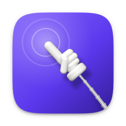
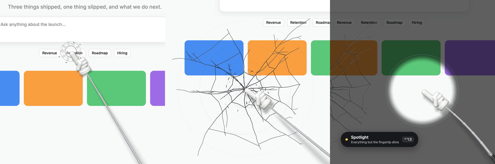
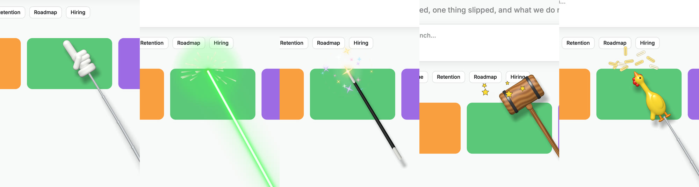
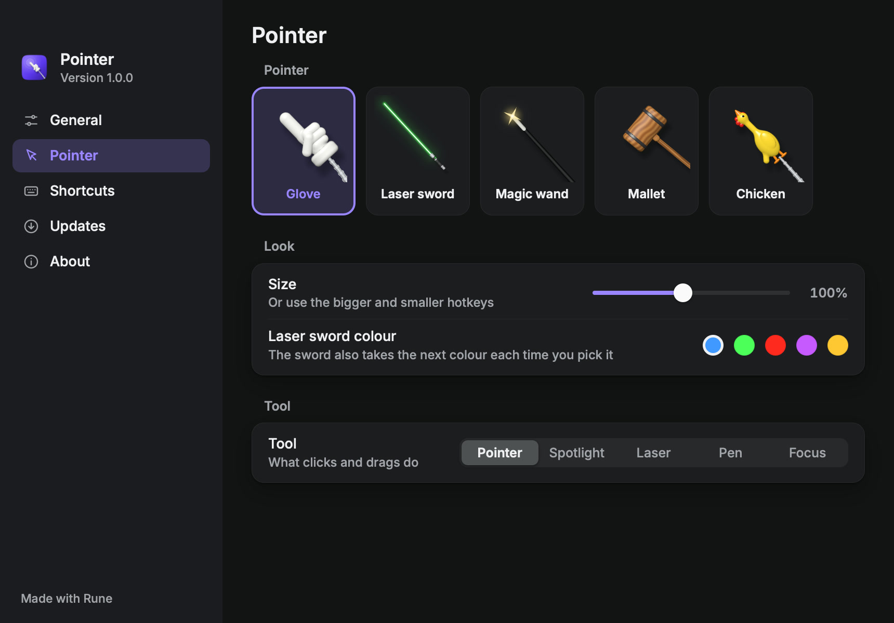

# Pointer

**[Download for Mac](https://github.com/nearbycoder/pointer/releases/latest/download/Pointer.dmg)** · [Website](https://nearbycoder.github.io/pointer/) · [Releases](https://github.com/nearbycoder/pointer/releases)

A giant cartoon glove on a telescoping pole that follows your cursor across your screens, with tools for showing people where to look. Click and the screen ripples with a pop. Tap fast or hold and the glass cracks with a crash and tinkling shards. There's also a spotlight, a laser trail, a pen and a focus box, each with its own sound.



There are five pointers to choose from, each with its own click and sounds: the glove, a laser sword, a magic wand, a mallet and a rubber chicken.



It's built on [Rune](https://github.com/anomalyco/rune), a GPU-rendered Rust UI framework. Each display gets a transparent, click-through Rune overlay, and a Rune compositor draws the pointer and its effects with custom WGSL shaders at the display's refresh rate.

## Install

[Download Pointer.dmg](https://github.com/nearbycoder/pointer/releases/latest/download/Pointer.dmg), open it and drag Pointer into Applications. It's signed with a Developer ID and notarized by Apple, and runs on macOS 13 or later, on Apple silicon and Intel.

Pointer lives in the menu bar (the pointing hand), not the Dock. Its first launch opens Settings. From then on, the menu bar item or ⌃⌥, brings Settings back, and it updates itself from this repository's releases (see [Updates](#updates)).

## Run it from source

You need macOS and a Rust toolchain ([rustup](https://rustup.rs)). The pinned toolchain in `rust-toolchain.toml` installs itself on first build.

```sh
source ~/.cargo/env   # only if `cargo` isn't on your PATH
cargo run --release
```

The first build compiles Rune and takes a minute or two. After that the pointer appears on the display your cursor is on, and a toast tells you which tool is out. There's no Dock icon. Press ⌃⌥Q, or Ctrl+C in the terminal, to quit.

No permission prompts: the cursor and buttons come from CoreGraphics' system-wide state, and the hotkeys are Carbon hotkeys.

## Hotkeys

These work from any app. Press ⌃⌥/ to see them on screen.

| Keys | What it does |
| --- | --- |
| ⌃⌥P | Show or hide the pointer (the pole slides out from the bottom of the screen and back) |
| ⌃⌥S | Next pointer: glove, laser sword, magic wand, mallet, rubber chicken |
| ⌃⌥1 | **Pointer**: clicks ripple; five quick taps, or a press held still, crack the glass |
| ⌃⌥2 | **Spotlight**: everything dims except a circle around the fingertip |
| ⌃⌥3 | **Laser**: the fingertip leaves a glowing trail that fades |
| ⌃⌥4 | **Pen**: drag to draw ink (Esc to finish) |
| ⌃⌥5 | **Focus**: drag a box and everything outside it dims (Esc to finish) |
| ⌃⌥X | Smash the glass where the fingertip is |
| ⌃⌥Z | Clear ink, cracks and the focus box |
| ⌃⌥] / ⌃⌥[ | Bigger or smaller pointer |
| ⌃⌥C | Show or hide the system cursor under the glove |
| ⌃⌥M | Sound on or off |
| ⌃⌥0 | Frame-rate readout |
| ⌃⌥/ | Show every hotkey on screen |
| ⌃⌥, | Settings |
| ⌃⌥Q | Quit |

Every one of these can be changed, or cleared, in Settings → Shortcuts.

Pointer, Spotlight and Laser pass every click through to the app underneath, so you keep working while you point. Pen and Focus take the mouse while they're out, so drawing doesn't click the app underneath. Esc, or any other tool, gives the mouse back. Pointer, size, tool, cursor, sound and readout choices are remembered between launches (`~/Library/Application Support/Pointer/prefs.json`).

If another app already owns one of these key combinations, Pointer says so at startup and marks it in Settings → Shortcuts, where you can pick another. The rest still work.

## Settings and the menu bar



The menu bar item shows or hides the pointer, switches pointers and tools, and opens Settings, the update check and Quit. Settings has five pages:

| Page | What's there |
| --- | --- |
| General | Open at login, sound effects, hiding the system cursor, the frame-rate readout |
| Pointer | The five pointers, the pointer's size, the laser sword's colour, the tool |
| Shortcuts | A recorder for every hotkey: click one and press the keys you want. Backspace clears it, Esc cancels, and Restore defaults puts them all back |
| Updates | This version, the latest release and its notes, Install and relaunch, automatic checks |
| About | Links to the website, the source and the issue tracker |

Changes apply at once, from the window, the menu or a hotkey, and every place shows the same state.

## Updates

The installed app asks GitHub for this repository's latest release at launch (after a few seconds) and every six hours, unless you turn that off in Settings → Updates. When the release's version is newer than the running one, a toast and the menu bar item say so. Install and relaunch then:

1. downloads the release's `Pointer.zip` with the system's `curl`,
2. unpacks it with `ditto` and checks it with `codesign --verify --deep --strict`,
3. checks that it's signed by the same Apple team as the running app and that its version matches the release,
4. swaps it in place of the running app (keeping the old one until the new one is in place), and relaunches.

An app running from the disk image or from a translocated folder can't replace itself, so Pointer asks you to move it into Applications first. A development build (`cargo run`) checks for updates but never installs one.

The same update runs from the terminal: `/Applications/Pointer.app/Contents/MacOS/Pointer --update`. To try one without an older build, set `POINTER_UPDATE_AS=0.9.0` and the app compares releases with that version instead of its own.

## The pointers

⌃⌥S swaps the pointer: the one that's out slides away and the next one comes in. Each makes its own click, but the tools and the cracking glass work with all of them.

| Pointer | Looks like | Click | Sounds |
| --- | --- | --- | --- |
| **Glove** | A cartoon glove on a telescoping pole | A burst of ticks and ripples | A soft pop |
| **Laser sword** | A glowing blade on a metal hilt, lighting the page around it; swings leave an afterimage | A flash, a spray of sparks and a scorch mark | A snap-hiss as it lights, a hum that swells as it swings, a crackling clash |
| **Magic wand** | A magician's black-and-white wand that sheds sparkles as it moves | A puff and a burst of stars | Tinkles as it moves, a rising arpeggio when it casts |
| **Mallet** | A wooden mallet with iron bands | Impact lines, a dust puff, and stars circling the spot it hit | Bonk, then a cartoon boing |
| **Rubber chicken** | A rubber chicken on the telescoping pole | Feathers fly up and drift down | Squawk |

The sword's blade takes a new colour each time you pick it: blue, green, red, purple or gold.

## The glove

The fingertip sits exactly on your cursor, and the system cursor is hidden while the glove is out (⌃⌥C turns that off). The rest of the rig follows physically:

- The pole's base trails behind on a slow spring, like someone holding the stick from below the screen.
- The middle of the pole is a damped mass, so the pole bends and wobbles when you move fast.
- The glove turns with the pole and rolls a little as you move sideways.
- The glove dips toward the screen when you press, and its shadow tucks in under it.

The glove is raymarched in 3D in the fragment shader: soft wrap lighting, ambient occlusion and a dark rim keep it readable on white pages and dark ones. The pole is polished telescoping aluminium with a collar at each joint and a rubber grip, and both cast soft shadows onto the screen.

On several displays, the pointer lives on whichever one has the cursor. It retracts from the display you leave and extends on the one you enter. Effects stay on the display where they happened. The overlays sit above pop-up menus, appear on every Space and over full-screen apps, and show up in screen recordings.

## Sound

Every effect has a sound, synthesized as it plays from oscillators, noise and filters, with no audio files. Taps land a few milliseconds after the click, because the mix goes straight to a CoreAudio output unit rather than through a media player.

| When | What you hear |
| --- | --- |
| The pole slides out or back | a rising (or falling) rush with a click for each section, then a clack |
| A tap | a soft pop with a little tick, its pitch varied a touch each time |
| The charge dial filling | a tick per lit segment, over a whine that climbs and crackles as it nears full |
| The glass breaking | a thump and a snap, crackle running outward, tinkling shards and a whoosh |
| Spotlight | a stage light clunking on |
| Laser | a hum with a sizzle, louder and higher the faster you move |
| Pen | felt tip on glass while you draw |
| A focus box landing, clearing, resizing, switching tools | a whomp, a sweep, a bloop and a two-note chime |
| The other pointers | see [The pointers](#the-pointers): a laser sword, a magic wand, a mallet and a rubber chicken each have their own |

Sounds pan a little toward the side of the screen they happen on. Only the display with the cursor makes them. ⌃⌥M turns them off. When nothing is sounding, the audio output stops after a few seconds, so an idle pointer costs no CPU.

## Smoothness and 120 Hz

Rune paces each overlay with the display's own display link: one frame per refresh, so a 120 Hz ProMotion panel runs at 120 fps and a 60 Hz panel at 60. Physics are sub-stepped at 600 Hz, so motion looks the same at any rate. When nothing moves, the overlay stops drawing entirely. A small sampler thread wakes it the moment the mouse moves or clicks on its display.

Measured on an M4 Max:

| | |
| --- | --- |
| Live overlay on a 4K display | a steady 60 presents/s on its 60 Hz panel; 0 failed or skipped frames; 0.10 to 0.19 ms of CPU per frame |
| Headless, full demo at 3840×2160 and 120 fps | 2,040 frames in 16.2 s (126 frames/s) *including* reading back and H.264-encoding every frame; 0.165 ms mean CPU per frame (0.28 ms p95) |

A frame at 120 Hz has 8.3 ms, so the pointer uses only a sliver of the budget. To see it live, press ⌃⌥0 for the readout, or run with `POINTER_DEBUG=1` to print frame rates and Rune's per-overlay surface stats (presents, skipped and failed frames, pacing) to the terminal.

## Rendering without a window

Rune apps can run headless on the same renderer. Pointer then draws one 1920×1080 stage over a sample slide, driven by scripted mice:

```sh
cargo run --release -- --list-scenes
cargo run --release -- --scene crack --snap crack.png --at 1.9
cargo run --release -- --scene demo --video demo.mp4 --duration 17                      # the whole tour
cargo run --release -- --scene demo --video demo-4k.mp4 --duration 17 --scale 2 --fps 120  # 4K, 120 fps
scripts/snaps.sh                                                                         # every scene, tiled into one sheet
scripts/demo.sh out/demo.mp4                                                             # the tour with its sound
scripts/demo.sh out/styles.mp4 1 60 styles                                               # every pointer, with sound
```

Headless runs never play sound. With `POINTER_AUDIO=sound.wav` set, they render the run's sound effects into a WAV, in sync with the frames. `scripts/demo.sh` does that and muxes the picture and sound together with ffmpeg.

Rune's `--script` input files work too, including `{"t": 1.2, "type": "shortcut", "chord": "ctrl+alt+2"}` to press a hotkey.

## Releasing

`scripts/bundle.sh` builds the release: a universal binary (Apple silicon and Intel), the app bundle, its Developer ID signature with the hardened runtime, notarization and stapling, then `dist/Pointer.zip` (what the updater downloads) and `dist/Pointer.dmg` (what the website links). It needs a "Developer ID Application" identity in the keychain and a notarytool keychain profile, `pointer-notary` by default:

```sh
xcrun notarytool store-credentials pointer-notary --key AuthKey_XXXXXXXXXX.p8 --key-id XXXXXXXXXX --issuer <issuer-uuid>
scripts/bundle.sh                 # signed and notarized
POINTER_SIGN=- scripts/bundle.sh  # ad-hoc signed, for trying the bundle locally
```

To publish, bump `version` in `Cargo.toml`, run the script, and create a GitHub release tagged `v<version>` with both files attached under exactly those names:

```sh
gh release create v1.0.1 dist/Pointer.dmg dist/Pointer.zip --title "Pointer 1.0.1" --notes "…"
```

Installed copies pick it up within six hours, and the website's download buttons point at `releases/latest`, so they need no change.

The artwork is rendered by the app itself: `scripts/art.sh` makes the icon (and `AppIcon.icns`) and the settings window's pointer thumbnails, and `scripts/site-media.sh` makes the website's film, clips, screenshots and social card. The website is `docs/`, served by GitHub Pages.

## How it's put together

| File | What's in it |
| --- | --- |
| `src/main.rs` | One Rune overlay per display, the hotkeys, Ctrl+C handling, and the headless scenes |
| `src/stage.rs` | One display's state: input, the press/hold/drag logic for each tool, idling, the sampler thread |
| `src/sim.rs` | The rig's physics: springs for the base, the bend, the press, the roll and the recoil |
| `src/fx.rs` | Each pointer's click burst, the wand's sparkles, the charge dial, cracks and shockwaves, the laser trail, ink, the spotlight and focus dimming |
| `src/style.rs` | The five pointers: names, sizes, and how each hangs off the rig |
| `src/pointer.rs` | Turns the rig's pose into the pointer: the pole and its shadows, the glove and the chicken, the sword, the wand and the mallet |
| `src/draw.rs` | The frame's geometry: instanced signed-distance quads, and ribbons for strokes |
| `src/gpu.rs` | The Rune compositor: uploads the frame and draws it at the view's two effect slots |
| `src/shader.wgsl` | The shapes, the blade and stars, chrome, rubber, lacquer and wood, and the raymarched glove, chicken and mallet head |
| `src/hud.rs` | The Rune view: the effect slots around the toast, the hotkey card and the readout |
| `src/audio.rs` | The sound effects: a small synthesizer, the CoreAudio output, and offline rendering to WAV |
| `src/input.rs` | The system-wide mouse and hiding the system cursor (CoreGraphics) |
| `src/settings.rs`, `src/actions.rs` | Settings shared across displays and saved between launches, and what each hotkey does |
| `src/bindings.rs` | Every action's name and default chord, and the user's changes to them |
| `src/ctl.rs` | The app behind the settings window: registers the hotkeys, steers the overlays, answers the menu, checks for and installs updates |
| `src/panel.rs` | The settings window's view, with rune-kit's shortcut recorder |
| `src/menubar.rs` | The menu bar item (AppKit through objc2) |
| `src/update.rs` | Release checks and the download, verify and swap of an update |
| `src/login.rs` | Open at login (`SMAppService`) |

Effects are drawn under the HUD and the pointer is drawn over it. Rune calls the compositor at two `El::effect` slots in painter order, so the toast never covers the glove.

Cracks are generated procedurally: jagged spokes with branches, rings of chords between the spokes, and a shattered core. They grow outward from the impact, last about three seconds and fade.

## Notes

- macOS only for now. Rune itself is cross-platform, but the system-wide mouse sampling and cursor hiding here are macOS calls.
- Displays are read at launch. Restart Pointer after plugging in or rearranging monitors.
- Hiding the cursor while another app is in front uses WindowServer's private `SetsCursorInBackground` switch, which Rune's own `macos-background-cursor` feature also uses. If the process dies, macOS shows the cursor again.
- Rune's `Player::audio` plays sound files through AVPlayer, which suits music and recordings. Its start-up delay is too long for a click, though, so the sound effects use their own low-latency output.
- `cargo test` runs the physics, effect and sound tests.
